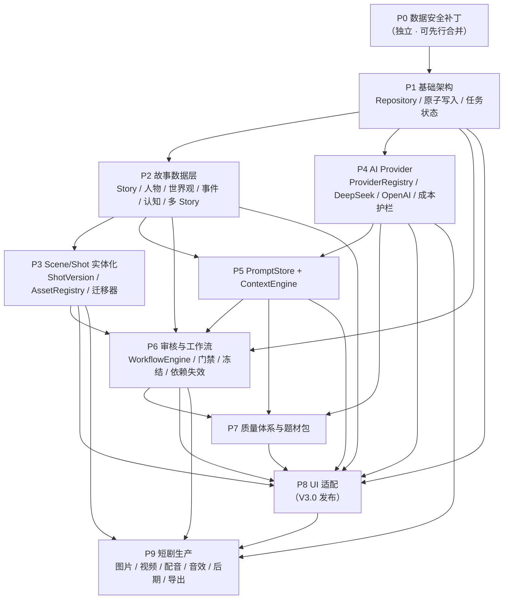
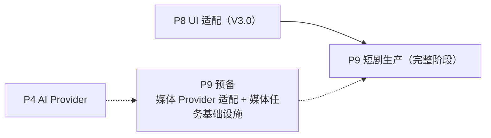

# V3 STAGE 0.5 / 0.6 — 开发路线

日期：2026-11-05
状态：**Stage 0.6 修订版**（取代 Stage 0.5 版同名文件）
关联：[目标架构](V3_STAGE0_TARGET_ARCHITECTURE.md)、[迁移方案](V3_STAGE0_MIGRATION_PLAN.md)、[MVP 范围](V3_STAGE0_5_MVP_SCOPE.md)、[架构决策](V3_STAGE0_5_ARCHITECTURE_DECISIONS.md)、[Stage 0.6 冻结基线](V3_STAGE0_6_FINAL_BASELINE.md)

> Stage 0.6 修订点：P9 改为**依赖 P3/P4/P6/P8 的完整阶段**，不再描述为「与 P7 部分并行」；新增 §2.3「P9 预备工作」；新增 §3.4 真实端到端验收（审查问题 9）；P4 验收改为 9 槽位；P6 验收引用唯一阶段定义表。

---

## 1. 阶段总表

| 阶段 | 名称 | 核心产出 | 交付形态 |
| --- | --- | --- | --- |
| **P0** | V2.3 数据安全补丁 | K-01 / K-02 / A-05 只读检测 / A-03 来源标记 | V2.3 独立补丁发布（不依赖 V3） |
| P1 | 基础架构（9 个 Repository 接口契约中的 ProjectStore / VersionStore 先行落地，其余按阶段接入） | Repository 接口 / 原子写入 / 任务状态 / 基础测试 | 内部（格式不变） |
| P2 | 故事数据层 | Story / Character / Relationship / WorldSetting / PlotEvent / KnowledgeState / 多 Story | 可读写（无 UI） |
| P3 | Scene/Shot 实体化 | SceneRepository / ShotRepository / ShotVersion / AssetRegistry / 单镜重生成 / 迁移器 | 可迁移旧项目 |
| P4 | AI Provider | ProviderRegistry / DeepSeek / OpenAI / ChatRequest-Result / UsageLedger / CostGuard | 可切换模型 |
| P5 | PromptStore + ContextEngine | Prompt 版本 / ContextBundle / Token 预算 / 三层信息 / 冲突测试 | 上下文可用 |
| P6 | 审核与工作流 | WorkflowEngine / ReviewRecord / 门禁 / 冻结 / 退回 / DependencyAnalyzer | 人工门禁可用 |
| P7 | 质量体系与题材包 | AI 独立审核 / 多模型比较 / HorrorPack / GenrePack | V3.0 功能闭环 |
| P8 | UI 适配 | 工作台 / 故事编辑 / 人物中心 / 世界观中心 / 审核中心 / 镜头管理 / 模型对比 | **V3.0 发布** |
| P9 | 短剧生产 | 图片 / 视频 / 配音 / 音效 / 后期合成 / 导出 / 最终审核 | V3.x 增量（依赖 P3/P4/P6/P8，见 §2.3） |

---

## 2. 依赖关系图

说明：P2 与 P4 无相互依赖，可并行；P3 依赖 P1 + P2；P5 依赖 P2 + P4；P6 依赖 P1 + P2 + P3 + P5；P7 依赖 P4 + P5 + P6；P8 依赖 P1~P7；**P9 的完整生产流程依赖 P3 + P4 + P6 + P8**。

### 2.1 依赖表（机器可校验形式）

| 阶段 | 依赖 | 可并行 |
| --- | --- | --- |
| P0 | — | 独立于 V3 |
| P1 | P0（K-01 修复后才允许改动项目读写路径） | — |
| P2 | P1 | 与 P4 并行 |
| P3 | P1, P2 | 与 P4 并行 |
| P4 | P1 | 与 P2 / P3 并行 |
| P5 | P2, P4 | — |
| P6 | P1, P2, P3, P5 | — |
| P7 | P4, P5, P6 | — |
| P8 | P1, P2, P3, P4, P5, P6, P7（即 P1~P7） | — |
| P9 | **P3, P4, P6, P8** | **不与其他阶段并行；只有「P9 预备工作」可在 P6 之后提前进行（§2.3）** |

### 2.2 拓扑排序与循环依赖校验

按上表归一化依赖关系（P8 展开为 P1~P7）后拓扑排序，可得到**合法顺序之一**：

`P0 → P1 → P2 → P4 → P3 → P5 → P6 → P7 → P8 → P9`

（P2 与 P4 无依赖关系，先后可交换；P3 只依赖 P1/P2，也可放在 P4 之前。）

- 顺序推进：P1 → P2 → P3 → P4 → P5 → P6 → P7 → P8 → P9
- 并行推进：P2/P3 与 P4 双线同时开发，合并顺序固定为 P2 → P3 → P4 → P5
- **无循环依赖**（上面给出的任何一个顺序都满足所有依赖边）。

### 2.3 P9 的真实位置与「P9 预备工作」

**修正的旧表述**：Stage 0.5 的依赖表写「P9 | P3, P4, P6, P8 | 与 P7 部分并行（审核接口已稳定）」。这个表述**不准确**：它暗示 P9 阶段可以与 P7 / P8 并行推进，与依赖表「P9 依赖 P8」自相矛盾。

**Stage 0.6 的结论**：

1. **P9 是完整阶段，依赖 P3、P4、P6、P8，不得与 P8 并行启动。** 完整生产流程需要：镜头实体与资产注册（P3）、图像/视频/配音/音效 Provider（P4）、审核门禁（P6）、以及调用它们的 UI（P8）。
2. **P9 的预备工作可以提前**，但**只能以「预备」身份存在**，不等于 P9 阶段已开始：

| 预备项 | 最早可开始 | 交付形态 | 限制 |
| --- | --- | --- | --- |
| 图片 Provider 适配（`image` 槽位） | P4 完成后 | 一个可通过 Mock 测试的 `<ImageProvider>` 实现 + 接口 | 不接 UI、不建生产流程；不得声称「图片生成功能已完成」 |
| 视频 Provider 接口（`video` 槽位） | P4 完成后 | 接口定义 + 未实现实现类 | 同上 |
| 音频 Provider 接口（`voice` / `audio` 槽位） | P4 完成后 | 两个接口定义 + 本地已配音引擎的适配层 | 同上 |
| 媒体任务基础设施 | P1 完成后（与 P6 无强依赖） | 媒体任务状态模型（进度 / 取消 / 重试 / 并发） | 不依赖审核门禁；不得被描述为 P9 阶段完成 |

3. **预备工作的验收不算 P9 出口条件**；P9 出口条件见 §3「P9 — 短剧生产」。
4. 开发路线中若需要图示预备工作的位置，使用虚线表示，并标注「预备」，例如：

---

## 3. 各阶段验收标准

### P0 — V2.3 数据安全补丁

| 项 | 验收 |
| --- | --- |
| K-01 | `_normalize_story` 失败路径不再 `data.pop("story")`；story 原样保留；有回归测试；打开项目后 story 字节不变 |
| K-02 | 导入故事改为暂存-提交；任一步失败后 `project.json` 与导入前字节一致 |
| A-05 | 增加只读检测：index 对齐与 shot_id 对齐结果不一致时告警（不改现有行为） |
| A-03 | 版本记录 `source`（human/batch/import）；导入不占正式额度 |
| 回归 | 309 个原有用例全绿；新增用例覆盖上述四项 |

**出口**：V2.3 补丁可独立发布；**迁移入口 `assert_p0_fixed()` 通过**。

### P1 — 基础架构

| 项 | 验收 |
| --- | --- |
| Repository 接口 | 至少 `ProjectStore` / `VersionStore` 接口定义完成（**9 个接口的完整落地分属 P1~P3**：`SharedResourceStore`/`CharacterRepository` 属 P2，`SceneRepository`/`ShotRepository`/`AssetRegistry` 属 P3）；V2 读写路径改走接口但**数据格式不变** |
| 原子写入 | 统一 `tmp.replace`；写入失败不破坏原文件（有测试） |
| 任务状态 | 后台任务状态模型（进行中/成功/失败/取消）可用于 P4 并发 |
| 基础测试 | 快照测试证明行为与 V2 等价；架构测试（import 方向）建立 |

**出口**：V2 项目在新接口下行为完全等价，无格式变更。

### P2 — 故事数据层

| 项 | 验收 |
| --- | --- |
| 实体 | Story / Character / CharacterRelationship / WorldSetting / PlotEvent / CharacterKnowledgeState 全部 CRUD |
| 多 Story | 一个项目两篇 story 互不干扰 |
| 引用完整性 | 删除被引用实体被阻塞 |
| 存储 | 目录化 JSON + `index.json` 可重建 |
| 共享资源审核 | `SharedResourceStore` 支持 Project 级审核记录写入与查询（[目标架构 §6.3.2](V3_STAGE0_TARGET_ARCHITECTURE.md#632-共享资源审核记录归属p2--p6-实现约束)）；共享人物被两篇 Story 引用时各自可见 |
| 测试 | 每实体 CRUD + 引用 + 索引重建 |

**出口**：数据层可通过 Python API 完成全部实体操作。

### P3 — Scene/Shot 实体化

| 项 | 验收 |
| --- | --- |
| 实体 | Scene / Shot / ShotVersion / VisualAsset |
| 单镜重生成 | `ShotRegenerator` 只影响目标镜头；旧版本保留 |
| 迁移器 | [迁移方案 §5.1](V3_STAGE0_MIGRATION_PLAN.md#51-必须通过的项目形态) 的 **23 类**（12 类项目形态 + 9 类步骤级安全 + 2 类暂存副本安全；R4 新增日志/暂存隔离与哈希边界两类）全部通过 |
| 失败安全 | 所有失败场景证明原项目字节级不变 |
| 迁移中断 | 启动恢复可识别并可继续/回滚 |

**出口**：真实 V2 项目可安全迁移并人工核对。

### P4 — AI Provider

| 项 | 验收 |
| --- | --- |
| 接口 | `Provider` / `ProviderRegistry` / `ChatRequest` / `ChatResult` |
| 实现 | DeepSeek（迁移 V2 现有调用）+ OpenAI GPT |
| 槽位 | **9 槽位**（含 `audio`）解析；业务代码无模型名（静态扫描断言）；能力类型 5 个（TEXT/IMAGE/VIDEO/AUDIO/VISION）与槽位不混淆 |
| 媒体 | 媒体 Provider 接口与文本接口分离（`<ImageProvider>` / `<VideoProvider>` / `<SpeechProvider>` / `<AudioProvider>`） |
| Mock | Mock Provider 可支撑全部单测（不联网） |
| 成本 | UsageLedger + CostGuard；价格从配置读取 |
| 并发 | 默认 2，可配置；重复任务防护 |

**出口**：DeepSeek 与 GPT 可切换；同槽位可并行对比。

### P5 — PromptStore + ContextEngine

| 项 | 验收 |
| --- | --- |
| PromptStore | 7 字段；生成记录 prompt_id + version |
| 行为等价 | V2 内联 Prompt 抽成 v1 后五阶段生成结构不变（快照测试） |
| ContextEngine | 三层信息结构；capability 清单 §7.6 全部实现 |
| 测试 | T1~T11 全部通过（T11 跨 Story 共享人物场景） |
| Token 预算 | 超限先压缩弹性段；manifest 记录被裁段 |

**出口**：五阶段生成改由 ContextEngine 供上下文，输出结构不变。

### P6 — 审核与工作流

| 项 | 验收 |
| --- | --- |
| WorkflowEngine | **13 阶段定义表**（[目标架构 §6.1.1](V3_STAGE0_TARGET_ARCHITECTURE.md#611-唯一阶段定义表全文以此表为准)：stage_id / 名称 / ai_generation / ai_review / human_review / gate_required / pass_condition / reject_target / dependencies）；**9 个门禁的映射**（§6.1.2）按此实现；状态机全部合法/非法转换测试 |
| ReviewRepository | 只追加；`reviewer_kind` 区分；`supersedes` 链 |
| 门禁 | AI 通过不可自动放行；只有 `human_approved` 解锁下游；退回产生新版本（revision → 新 StoryVersion / Shot 版本） |
| 冻结 | 已审内容修改 → 新版本 + `pending`；原审核保留 |
| DependencyAnalyzer | 上游变更 → 下游 stale；已批准素材不被覆盖 |
| 退回分级 | `reject_target` 按问题性质分级（[目标架构 §6.1.5](V3_STAGE0_TARGET_ARCHITECTURE.md#615-reject_target-的通用判定规则与-audio_prod-的分级退回stage-06-终审修订)）：`audio_prod` 的音频技术 / 剧本内容 / 镜头表达三类问题分别路由到本阶段 / `full_story` / `shot_design`，有测试 |
| 共享资源审核归属 | [目标架构 §6.3.2](V3_STAGE0_TARGET_ARCHITECTURE.md#632-共享资源审核记录归属p2--p6-实现约束)：Story 级审核不得写共享资源；`supersedes` 不跨归属；同一共享人物两篇 Story 的审核用例 |

**出口**：全部重要阶段必须人工确认才能推进。

### P7 — 质量体系与题材包

| 项 | 验收 |
| --- | --- |
| AI 独立审核 | `reviewer` ≠ `writer`；审核上下文不含创作指令（T10） |
| 多模型比较 | 同 Prompt 同上下文并行；对比结果可记录 |
| HorrorPack | V2 `horror_rules` 行为等价（21 个测试） |
| GenrePack | 接口可容纳未知题材；新增题材不改业务代码 |

**出口**：V3.0 功能闭环，可进入 UI 适配。

### P8 — UI 适配

| 项 | 验收 |
| --- | --- |
| 工作台 | 项目 + 多 Story 入口 |
| 故事编辑 | 创意 → 大纲 → 角色/世界观 → 完整故事 各阶段界面 |
| 人物中心 / 世界观中心 | 实体 CRUD + 关系展示 |
| 审核中心 | 阶段列表 + 审核记录 + 通过/退回 |
| 镜头管理 | 镜头详情 + 版本 + 重生成 + 资产候选 |
| 模型对比 | UsageLedger + 审核分数对比 |
| 冒烟 | 每页签至少一条自动冒烟 |
| 兼容 | 旧 V2 项目可打开并提示迁移 |

**出口**：**V3.0 发布**。

### P9 — 短剧生产

| 项 | 验收 |
| --- | --- |
| 图片生成 | 通过 `image` 槽位；候选图入 AssetRegistry |
| 视频生成 | 通过 `video` 槽位（接口预留，视 Provider 接入情况） |
| 配音 / 音效 | 通过 `voice`（配音、语音合成）/ `audio`（音效、BGM）两个槽位，互不混用 |
| 后期合成 | `post_prod` 阶段产出 |
| 导出 | `export` 阶段前置 `final_review=human_approved` |
| 最终审核 | `final_review` 人工通过 |

**出口**：单集短剧可完整产出并导出。

---

### 3.4 真实端到端验收（Stage 0.6 新增）

> 单元测试与架构测试只能证明「逻辑正确」；V3 的核心风险在于**真实 Provider 行为、真实文件系统、真实人工门禁、真实 GUI**。因此每个阶段除单测外，还必须完成对应的真实端到端验收。

#### 3.4.1 十条端到端验收

> **E4 的验收口径（Stage 0.6 终审明确）**：E4 验证的是**完整流程是否走得通**（门禁顺序、版本生成、退回重生成、数据贯通、GUI 可见），不验证 Provider 接口本身。因此 E4 **允许使用 Mock Provider 或录制响应回放**。但 **E4 不替代 E1 / E2 的真实 API 验证**——Provider 真实调用（DeepSeek / GPT）必须由 E1 / E2 以真实 API 完成，E4 通过不能作为 E1 / E2 通过的证据。

| # | 测试 | 验收要求 | 所属阶段 | 是否需真实 API |
| --- | --- | --- | --- | --- |
| E1 | DeepSeek API | 通过 `planner` / `writer` / `concept` / `fast` 槽位真实调用成功；`ChatResult` 结构完整；解析链（`extract_content` → `parse_json_object`）在真实返回上工作；UsageLedger 记录 token | P4 | **是** |
| E2 | GPT API | 通过同一组槽位真实调用成功；与 DeepSeek 共用同一 `ChatRequest` / `ChatResult` 接口，业务代码零改动 | P4 | **是** |
| E3 | 模型对比 | 同一 `prompt_id` + 同一 `version` + 同一 `ContextBundle`（manifest 哈希一致）并行生成 ≥2 个结果（来自不同 `provider_id` / `model`）；两条结果各自入审核记录，可并排查看 | P7 | **是** |
| E4 | 故事完整流程 | 从空白项目出发：创意 → 大纲 → 人物与世界观 → 完整故事 → 场景拆分 → 镜头设计，逐阶段生成并逐阶段人工通过；中途至少一次退回修改并重新生成（验证产生新版本、旧审核记录保留）；最终能进入镜头管理页看到全部镜头 | P6 + P8 | 允许 Mock / 录制响应回放（见下方说明） |
| E5 | 人工门禁 | 未人工批准时：① UI 不允许进入下一阶段；② 直接调用后端流程被 WorkflowEngine 拒绝；③ `export` 在 `final_review` 未通过时被拒绝；④ AI 审核通过后状态仍为 `ai_passed`，不会被自动升级 | P6 | 否（Mock 即可） |
| E6 | 迁移中断 | 在迁移提交的**任意一个步骤**注入进程强杀（`os._exit` / 进程终止，非异常捕获），重启后：能够识别未完成事务 → 给出「继续 / 回滚」→ 执行后项目可用性与数据完整性符合预期；原始项目在「回滚」路径下字节级不变 | P3 | 否 |
| E7 | 镜头修改 | 修改并重新生成一个已批准的镜头：产生新版本、旧版本保留、可一键切回旧版本；该镜头下游（已批准素材）不被覆盖，只会标记过期 | P3 + P6 | 否 |
| E8 | 人物认知 | 构造「角色 A 不知道 X」的场景：生成 A 视角内容时，结果中不出现 X 的具体信息；构造「A 在事件 E 之后得知 X」：E 之前/之后的生成结果不同；AI 审核提示不泄露 X | P5 | **是**（真实模型可暴露提示注入泄漏） |
| E9 | 多 Story | 一个项目两篇 Story：各自的人物、事件、场景、镜头、认知、审核记录互不串扰；共享人物档案修改后，两篇 Story 都收到影响提示；索引可从目录重建 | P2 + P3 | 否 |
| E10 | GUI | 在真实 tkinter 窗口中完成：新建项目 → 进入 story 编辑 → 各阶段生成 → 审核中心通过/退回 → 镜头管理修改与重生成 → 查看审核记录 → 关闭重开数据仍在 | P8 | 否（可用 Mock Provider） |

#### 3.4.2 执行规则

1. **Mock 测试与真实 API 测试分开**：Mock 测试属于每次提交必跑的单元测试；真实 API 测试属于**专项验收**（独立脚本 + 独立标记，例如 `tests/live/` 或 `--live` 开关）。
2. **真实 API 测试不应成为每次单元测试的必跑项目**：CI / 本地单测默认不联网；真实测试只在阶段验收与回归演练时手动触发。
3. **API Key 不得写入报告**：所有验收报告、日志、提交说明中不得出现 Key 的任何片段（含前 4 位 / 后 4 位）。UsageLedger 只记录 `provider_id` / `model` / token / 估算成本，不记录 Key。
4. **真实调用产生的费用必须经过用户授权**：执行任何真实 API 验收前，必须先向用户说明预计调用次数、使用模型、预估费用并取得明确同意；未获授权不得执行。
5. **迁移端到端测试必须使用测试副本，禁止直接操作唯一原始项目**：先在项目外的副本上执行迁移演练；任何 `rm` / 覆盖 / 回滚操作只能作用于副本路径；迁移器的路径边界校验也必须在副本上验证。
6. **真实 GUI 测试**可以用人工操作 + 截图/日志记录的方式执行（V3.0 不要求全自动 GUI 测试），但每次验收必须留下可复现的操作步骤。
7. **失败即失败**：真实 API 测试失败时不得用 Mock 结果替代并标记「通过」；失败要记录原因（限流、Key 权限、模型下线等）并重新验收。
8. **E4 不替代 E1 / E2**：E4 允许 Mock 或录制回放，但 Provider 真实连通性只能由 E1（DeepSeek）/ E2（GPT）以真实 API 证明；E4 通过不得写入「真实 API 已验证」的结论。

#### 3.4.3 各阶段必须完成的最小端到端验收

| 阶段 | 必须完成 |
| --- | --- |
| P3 | E6（迁移中断）、E7（镜头修改） |
| P4 | E1（DeepSeek 真实调用）、E2（GPT 真实调用） |
| P5 | E8（人物认知） |
| P6 | E4（完整流程的后端部分）、E5（人工门禁） |
| P7 | E3（模型对比） |
| P8 | E4（完整流程的 GUI 部分）、E10（GUI 核心操作） |
| P2 | E9（多 Story 隔离） |

---

## 4. 阶段间交付物

每个阶段必须提交：

1. 本阶段任务书（独立文件，开发前审查）；
2. 变更报告（完成后的输出）；
3. 单元测试与回归结果（含 309 原有用例状态）；
4. 架构一致性检查（import 方向）；
5. 若涉及数据格式：迁移兼容性说明。

**未经 ChatGPT 审查，不得进入下一阶段。**

---

## 5. 与 V3.0 MVP 的对应

| V3.0 能力（[MVP §2](V3_STAGE0_5_MVP_SCOPE.md#2-v30-必须交付的能力21-项)） | 完成于 |
| --- | --- |
| 1 创建项目 | P1 |
| 2 一项目多故事 | P2 |
| 3~9 创意/大纲/人物/关系/世界观/事件/认知 | P2 |
| 10 生成完整多角色故事 | P5 |
| 11~12 DeepSeek/GPT 切换、多模型比较 | P4（切换）/ P7（比较产品化） |
| 13 独立 AI 审核 | P6 / P7 |
| 14 人工确认 | P6 |
| 15~16 版本与审核记录 | P1/P3/P6 |
| 17~18 Scene/Shot 实体、单镜重生成 | P3 |
| 19 不静默覆盖已审内容 | P6 |
| 20 旧项目安全迁移 | P3 |
| 21 项目级共享人物档案与世界观基础设定 | P2 |

---

## 6. 治理要求

1. 每个开发阶段单独任务书。
2. 每个阶段先审查代码，再修改。
3. 禁止一次性重写整个模块。
4. 禁止为了测试通过而删除原有测试。
5. 新功能必须有对应单元测试。
6. 数据迁移必须有独立测试。
7. 审核门禁必须有状态机测试。
8. ContextEngine 必须有冲突和人物认知测试。
9. Provider 必须支持 Mock 测试。
10. GUI 逐步增加自动化冒烟测试。
11. 每个阶段完成后输出变更报告。
12. 每个阶段必须经过 ChatGPT 审查后再进入下一阶段。
13. 重要功能必须有 Git 独立提交。
14. 禁止把未验证的功能标记为完成。
15. **真实 API 测试与 Mock 测试分开执行；真实调用前必须取得用户费用授权（§3.4.2）。**
16. **迁移类端到端测试只允许在测试副本上执行，禁止直接操作唯一原始项目（§3.4.2）。**
